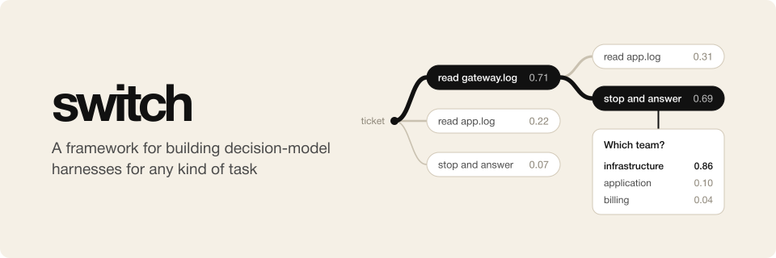

<p align="center">
  
</p>

# switch

switch is a framework for building decision-model harnesses for any kind of task.

A decision model reads some content, such as text or a JSON object, and answers typed questions about it. It picks one
of the answers that a question allows, rates the content on a scale, or gives the probability that a statement is true,
and every answer comes with the model's probabilities. It writes no text. TypeSafe calls them
[System One models](https://docs.typesafe.ai/concepts/system-one), and its Jev was the first. Open models followed:
llama.cpp [serves decision models](https://huggingface.co/blog/ggml-org/decision-models-in-llamacpp) through the same
API as Jev, and the Hugging Face Hub tags thousands of models as
[`decision-model`](https://huggingface.co/models?other=decision-model). The community
[Decision Index](https://huggingface.co/spaces/multimodalart/jev-decision-index) on Hugging Face compares many of
them with Jev on tasks such as tool use, retrieval, reasoning and games.

Decision models are fast and cheap, but they cannot write a tool call, so the usual agent loop does not fit them.
switch gives them a loop that does. At each step, your program asks the model typed questions about where the task is,
most often one pick from a short list of choices. Your program carries out the answers and shows the model where the
task is now, and this repeats until your program has nothing more to ask. The name comes from a railway switch, where
one track splits into a few: your program lays the tracks, and the model sets the switch.

The task itself comes from a domain, which you write in TypeScript. For each case, a domain gives a state machine: an
initial state, a question function that gives the questions that the model must answer in a state, and a transition
function that gives the next state from the answers. These three are the whole interface that a domain must give.
Behind them, a domain may use any library, program or data of its own, such as a chess engine. A pick from a list of
choices is one choice question, which switch's `picking` helper builds from the domain's choices. A domain may also
give the view function, which turns a state into what the model reads. switch runs the same loop for every domain and
keeps the model's probabilities for every answer of every step. It gives the view function a budget that fits the
model's window, asks for a smaller view when a request is still too long, and writes a trace of every state, which can
be replayed or forked. What goes to the model and comes back follows the classifier interface of
the [pi-ai](https://www.npmjs.com/package/@earendil-works/pi-ai) library, so any classifier model that pi-ai lists can
decide; [docs/DECISION_MODEL_API.md](docs/DECISION_MODEL_API.md) explains these APIs. Three example harnesses in
[`examples/`](examples) use switch the way another project would: `rubric-judge`, which grades answers to tasks against
a rubric, `chess`, and `wikirace`, which races from one Wikipedia article to another by following links. The
same loop fits any task where a model should look around before it decides, such as routing a support ticket after
reading its logs or deciding whether a report needs a person.

## How it works

Each case is a state machine. A run of one case goes like this:

1. The domain makes the case's **initial state**. A **state** is everything that the domain needs to know about where
   the case is, as JSON, such as the evidence read so far or the moves of a chess game.
2. The **question function** takes the latest state and gives the **questions** that the model must answer in it, by
   id: pi-ai's `bool`, `choice` and `score` questions. A **pick** is a choice question whose answers are the
   **choices** of the state, such as the logs to read or the legal moves. Each choice has a type, such as `read` or
   `move`, a key and a text that the model reads. The `picking` helper builds the pick from the domain's **choice
   function**: it checks the choices, cuts them to a limit and gives them short labels.
3. The **view function** takes the state and gives the **view**: the `decisionState`, a JSON object, and any
   `decisionImages` that the model sees with it. The model reads the view and gives an **answer** to every question,
   with its probabilities. The answer to a pick names the picked choice, with a probability for every choice.
4. The **transition function** takes the state and the answers, does the work that they ask for, such as the work of
   the picked choice, and gives the next state. One pass of the questions, the answers and the transition is a
   **step**.
5. The run goes back to the question function, until it gives no questions, a request fails, or the run reaches its
   step limit, a safety net that a domain may set. The result of the run is its last state, and a domain's
   **outcome** says how the case ended in the domain's own terms.

The **trace** of a run keeps every state, the questions of each step, the answers with the model's probabilities, and
how the run ended. So a replay reads the states from the trace and runs no transition again.

## Install

switch needs Node.js 22.18 or newer, which runs TypeScript sources without a flag, and pnpm. To use it in another project, add it pinned to a commit; installing
builds it.

```bash
pnpm add github:osolmaz/switch#<commit>
```

The package has these entry points:

| Import                    | What it gives                                                                                       |
| ------------------------- | --------------------------------------------------------------------------------------------------- |
| `@osolmaz/switch`         | The loop, the types of a domain and its state machine, the pick helper, traces and replay           |
| `@osolmaz/switch/models`  | `piAiDecider`, which asks a classifier model that pi-ai lists                                       |
| `@osolmaz/switch/cli`     | `commandLine`, which gives a harness the `run` and `replay` commands, and the functions behind them |
| `@osolmaz/switch/testing` | A fake decider that answers by a rule, for tests that make no model calls                           |

switch has no user interface. The web viewer that plays runs back in the browser is a package of its own,
[`viewer/`](viewer/README.md), which uses switch as the examples do.

To work on switch itself, clone it and run `pnpm install`.

## Examples

Each example is a package of its own in `examples/`, with a README that says what it does, what else it needs
installed and how to run it. Its program is `src/main.ts`, which runs from the repository root.

- [Rubric judge](examples/rubric-judge/README.md) (`rubric-judge`) grades a saved answer to a task against the task's
  rubric.
- [Chess](examples/chess/README.md) (`chess`) plays a game of chess against an opponent that picks random legal
  moves, against Stockfish, or against itself.
- [WikiRace](examples/wikirace/README.md) (`wikirace`) races from one Wikipedia article to a target article by
  following only the links on the pages it visits, the demo with which TypeSafe introduced Jev.

## Watch a run

A run folder keeps every case's trace, so another program can show it. The [viewer](viewer/README.md) is one: the
examples add its `view` command, which plays a run back in the browser step by step, and follows each case live while
it runs.

```bash
examples/chess/src/main.ts run examples/chess/cases/white-seed-1 --out runs/chess
examples/chess/src/main.ts view runs/chess
```

## Replay a case

`replay` runs a case again from its trace, under the trace's limits. It takes each recorded answer and each state from
the trace, so no transition runs and no model is asked. It ends as the recorded run ended, also at a failed request.
A replay thus gives the recorded case, even when a transition would find something else now, such as the reply of a
chess engine. It fails, and the command exits with an error, when the trace is of another domain or case, or when the
domain's code no longer asks the questions that the run answered: other ids or types, a recorded pick whose choice is
gone, questions where the run ended, or none where it asked. A recorded pick is found by its choice's key, so a choice
whose text or label changed since still fits. A definition that changed since is noted in the replay's trace. With
`--fork <n>`, `replay` repeats only the first n steps, and the model that `--model` names answers from there, with the
transitions running again. A fork thus also asks a case's last questions again under another definition or model, such
as rubric-judge's checks under another judge file. With `--out <folder>`, it writes the replay as a run folder of one
case, which the viewer can show:

```bash
examples/chess/src/main.ts replay examples/chess/cases/white-seed-1 runs/chess/cases/white-seed-1/trace.jsonl --fork 5 --out runs/fork
```

A run folder holds `run.json`, with what ran, the limits that the cases ran under, and, at the end, its totals: the
cases, the failed ones, the requests and their summed usage, cost included. Each case has its `result.json` with its
steps, why the run ended, why it failed if it did, the domain's outcome, and the error that stopped the case if one
did; its `trace.jsonl`; and its `requests.jsonl`, with every decision request and its result. When a stopped run goes
on, it runs again each case that has no result, or whose case was stopped by an error.

## Write a domain

A domain gives each case as a state machine. The state is JSON that the domain designs. The question function gives
the questions in a state, and the transition function does the work that the answers ask for and gives the next
state. The case's own data, which never changes, stays inside the functions. This domain routes a support ticket and
lets the model read the ticket's logs first:

```ts
import {
  type Choice,
  type ChoiceQuestion,
  type DomainShared,
  type JsonObject,
  picking,
  type StateMachine,
} from "@osolmaz/switch";

export interface Ticket {
  readonly text: string;
  readonly logs: Readonly<Record<string, string>>;
}

/** Where a ticket is: the logs read so far, with what each one said, whether reading is over, and the team. */
interface TriageState extends JsonObject {
  readonly read: readonly { readonly log: string; readonly text: string }[];
  readonly done: boolean;
  readonly team: string | null;
}

/** A log to read, or null to stop reading; the transition gets the choice back. */
interface ReadLog extends Choice {
  readonly log: string | null;
}

export const TRIAGE: DomainShared = { name: "triage", version: "0.1.0", limits: { steps: 20, windowShare: 0.9 } };

const TEAM: ChoiceQuestion = {
  type: "choice",
  instructions: "Which team should handle the ticket?",
  criteria: { billing: "Billing", infra: "Infrastructure", app: "Application" },
};

export function triageMachine(ticket: Ticket): StateMachine<TriageState> {
  const pick = picking<TriageState, ReadLog>({
    instructions: "Which log should be read next to route this ticket?",
    limit: 20,
    choices: (state) => [
      ...Object.keys(ticket.logs)
        .filter((log) => !state.read.some((entry) => entry.log === log))
        .map((log) => ({ type: "read-log", key: log, text: `Read ${log}`, log })),
      { type: "stop", key: "stop", text: "Stop reading: the evidence is enough", log: null, priority: -1 },
    ],
    transition: (state, { log }) =>
      Promise.resolve(
        log === null
          ? { ...state, done: true }
          : { ...state, read: [...state.read, { log, text: ticket.logs[log] ?? "" }] },
      ),
  });
  return {
    initial: () => Promise.resolve({ read: [], done: false, team: null }),
    questions: (state) => {
      if (state.team !== null) return {};
      return state.done ? { team: TEAM } : pick.questions(state);
    },
    transition: (state, answers) => {
      if (!state.done) return pick.transition(state, answers);
      const team = answers["team"];
      return Promise.resolve({ ...state, team: team?.type === "choice" ? team.choice : "unknown" });
    },
    view: (state) => Promise.resolve({ decisionState: { ticket: ticket.text, read: state.read } }),
  };
}
```

The model reads the ticket and opens logs one step at a time until it picks stop. In the next step it answers which
team should handle the ticket, and then the run ends, because the last state asks nothing. The questions are pi-ai's,
by id: a `bool`, a `choice` or a `score` question, each with its `criteria`. Every answer comes with the model's
probabilities. Only `initial`, `questions` and `transition` are needed: without a view function, the model reads the
state as it is.

`picking` turns a choice function into the question function and the transition function of a pick in each state. It
checks that the choices' keys and texts differ, keeps at most `limit` of them, the ones of lowest priority value,
labels them `o1`, `o2` and so on, and gives the transition the picked choice. A state with no choices asks nothing. A
domain that wants a stop choice gives it, as this one does, with a low priority so that a cut keeps it. A choice
function must leave out what the state says is done, since switch does not know which picks were made before. A view
function also gets the most tokens that its view may take, and the decider's characters per token, so that it can
measure with `estimateTokens`; when the model says that a request was still too long, switch asks it for a smaller
view. The limits are the share of the model's window that a request may fill and, as a safety net, the most steps of
a run, which is none unless the domain sets it. Any classifier model that pi-ai lists can decide; pi-ai finds its key
in the environment, such as `TYPESAFE_API_KEY`:

```ts
import { builtinModels } from "@earendil-works/pi-ai/providers/all";
import { run } from "@osolmaz/switch";
import { piAiDecider } from "@osolmaz/switch/models";

const decider = piAiDecider("typesafe/jev-latest", { registry: builtinModels() });
const result = await run(TRIAGE, triageMachine(ticket), decider);
```

`result.state` holds the last state, and `result.trace` every state, the questions of every step, and the answers with
the model's probabilities. `result.ended` tells why the run ended: `done` when the domain asked nothing more,
`step limit`, or `failed` when a request failed or gave answers that do not fit its questions, with the reason in
`result.error`. A domain may ask several questions in one step, such as one about each part of an item, and switch
splits them into batches when they do not fit one request. A domain with several types of choice can give each type in
a file of its own with `choiceType`, and join them with `joinTypes`, which gives `picking` its choice function and its
transition. A type's transition gets the picked choice's key, which `typedKey` makes from the type and the key within
it, so that the state can record what is done under the same key that the choice function leaves out.

## Write a harness

A harness is a program that runs a domain on case folders. Its setup function returns a runner. The runner holds what
every case shares, the definition, how to read a case's id, how to load a case folder's state machine, and, when the
domain has one, how a case ended, from the run's result. The definition holds what a domain lets a run vary, such as
the texts that tell the model what to do, and the limits; `run.json` records it with its hash, and each trace starts
with that hash and the case's id. The texts in the domain's code, such as those of its choices, come with the
domain's version. By default, the definition is the domain's limits, and a domain set up from a file of its own gives
that file as its definition. This setup needs nothing, and reports the team as the case's outcome:

```ts
import { basename } from "node:path";
import { type Runner, runnerOf } from "@osolmaz/switch";
import { TRIAGE, triageMachine } from "./index.ts";
import { loadTicket } from "./load.ts";

export function triageSetup(): Promise<Runner> {
  return Promise.resolve(
    runnerOf({
      ...TRIAGE,
      caseId: (folder) => Promise.resolve(basename(folder)),
      load: async (folder) => triageMachine(await loadTicket(folder)),
      outcome: ({ state }) => ({ team: state.team }),
    }),
  );
}
```

`commandLine` turns the setup into the harness's program, with switch's `run` and `replay` commands. It is a
[Commander](https://github.com/tj/commander.js) program, so the harness can add its own commands, as `rubric-judge`
adds `ingest`, `score` and `compare`, and the examples add the viewer's `view`:

```ts
import { commandLine } from "@osolmaz/switch/cli";
import { triageSetup } from "./setup.ts";

await commandLine({ triage: { setup: triageSetup } })
  .name("triage")
  .parseAsync();
```

Each domain of a harness is a `DomainSetup`: its setup function, and the flags of its own, which `run` and `replay`
then take. `setup` gets their values by name. For example, `rubric-judge` declares
`flags: [{ flag: "--judge <file>", description: "…" }]`, and its setup reads the judge file from `flags["judge"]`. A
harness with more than one domain takes `--domain` to pick one. The model's API key comes from the environment
variable that `--api-key-env` names, or pi-ai finds the provider's own, such as `TYPESAFE_API_KEY`.
[`examples/rubric-judge/`](examples/rubric-judge), [`examples/chess/`](examples/chess) and
[`examples/wikirace/`](examples/wikirace) are complete harnesses, and
[docs/MATH.md](docs/MATH.md) explains the loop in symbols.

## License

[MIT](LICENSE)
